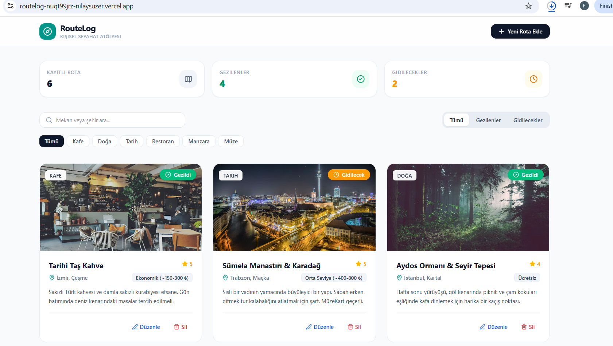

# 🧭 RouteLog — Kişisel Keşif & Gezi Rehberi

Kullanıcıların ziyaret ettikleri ve gitmeyi planladıkları mekanları kayıt altına alıp yönetebildikleri, modern web standartlarıyla geliştirilmiş dinamik bir seyahat & keşif paneli.

🔗 **Canlı Önizleme:** [Canlı Site Linki](https://routelog-lime.vercel.app)  
📂 **Kaynak Kodları:** [GitHub Deposu](https://github.com/NilaySuzer/routelog)

---

## 📸 Ekran Görüntüsü



---

## 🎯 Projenin Amacı ve Özellikleri

RouteLog, klasik "Yapılacaklar Listesi (Todo App)" mantığını modern ve gerçekçi bir seyahat rehberi konseptine taşır. Proje kapsamında aşağıdaki temel frontend yetkinlikleri uygulanmıştır:

* **Tam Kapsamlı CRUD Yönetimi:**
  * **Ekle (Create):** Mekan adı, konumu, kategorisi, tahmini bütçesi, puanı, görseli ve özel keşif notlarıyla yeni rota kaydı oluşturma.
  * **Listele & Filtrele (Read):** Ziyaret durumuna (*Gezilenler* / *Gidilecekler*) ve kategorilere (*Kafe, Doğa, Tarih, Restoran, Manzara, Müze*) göre anlık listeleme ve arama çubuğu ile dinamik metin araması.
  * **Güncelle (Update):** Var olan rota bilgilerini düzenleme ve kart üzerindeki butonla ziyaret durumunu tek tıkla güncelleme.
  * **Sil (Delete):** Kullanıcı onay mekanizması eşliğinde rotayı arşivden kaldırma.
* **Kalıcı Veri Depolama (LocalStorage):** Sayfa yenilendiğinde verilerin kaybolmaması için tarayıcı hafızasıyla çift yönlü senkronizasyon.
* **Canlı Durum Sayaçları:** Toplam, gezilen ve planlanan mekan sayılarını anlık takip eden özet istatistik paneli.
* **Duyarlı (Responsive) Tasarım:** Mobil, tablet ve masaüstü ekranlarda kusursuz çalışan esnek grid yapısı.

---

## 🛠️ Kullanılan Teknolojiler

* **React 19** — Bileşen tabanlı kullanıcı arayüzü mimarisi
* **Vite** — Hızlı modern derleyici ve geliştirme ortamı
* **Tailwind CSS v4** — Modern ve esnek stil kütüphanesi
* **Lucide React** — Minimalist ve işlevsel SVG ikon seti
* **LocalStorage API** — İstemci taraflı kalıcı veri saklama

---

## 📁 Proje Dosya Yapısı

```text
src/
├── components/          # Yeniden kullanılabilir UI bileşenleri
│   ├── PlaceCard.jsx    # Rota kartı bileşeni
│   └── PlaceModal.jsx   # Ekleme & düzenleme form modalı
├── pages/               # Sayfa görünümleri
│   └── Home.jsx         # Ana yönetim paneli ve CRUD kontrol merkezi
├── interfaces/          # Veri modelleri ve şablonlar
│   └── mockPlaces.js    # İlk açılış için örnek rota kayıtları
├── App.jsx              # Ana uygulama giriş bileşeni
├── index.css            # Tailwind CSS direktifleri
└── main.jsx             # React DOM kök bağlantısı
´´´
🚀 Yerel Kurulum ve Çalıştırma
Projeyi yerel makinenizde çalıştırmak için aşağıdaki adımları izleyin:

Repoyu klonlayın:

Bash
git clone [https://github.com/kullanici-adin/routelog.git](https://github.com/kullanici-adin/routelog.git)
cd routelog
Gerekli bağımlılıkları yükleyin:

Bash
npm install
Geliştirici sunucusunu başlatın:

Bash
npm run dev
Tarayıcınızda açın:

Plaintext
http://localhost:5175

📦 Dağıtım (Deployment)
Proje Vercel üzerinde canlıya alınmıştır.
Otomatik build ayarları:

Build Command: npm run build

Output Directory: dist
